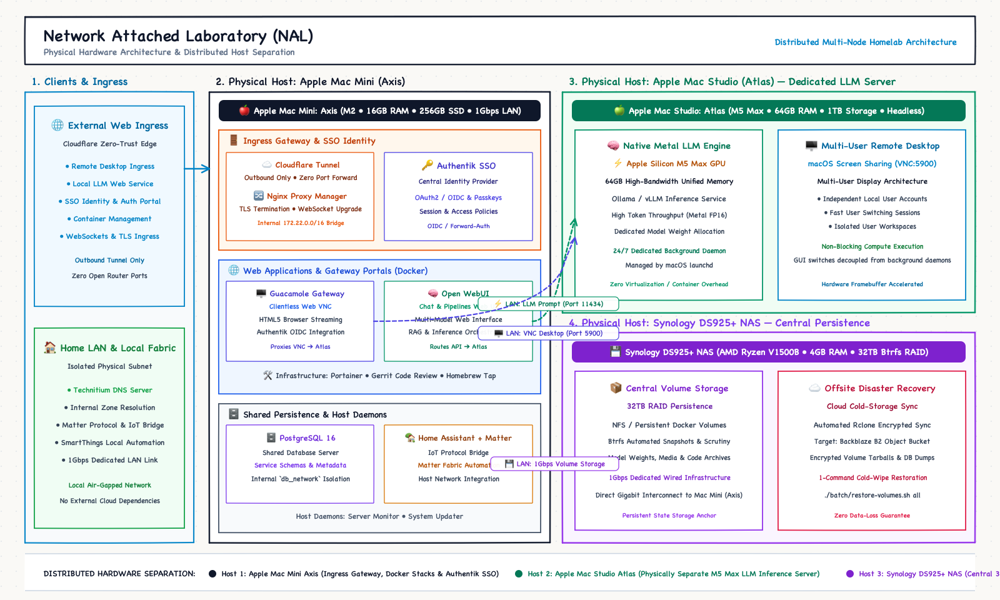

<p align="center">
  
</p>

# Network Attached Laboratory (NAL) Server

A set of configurations for homelab servers. All sensitive data are ignored/masked. Currently all configurations are written in compose config format, with plans to migrate to Kubernetes in the future.

## Architecture

Conceptual overview of access paths, security boundaries, compute services, and storage infrastructure:

<p align="center">
  
</p>

## Hardware Specifications

All infrastructure is running on the following hardwares.

### Apple Mac Mini (Axis)

- Role: Ingress Gateway & Container Virtualization Host
- Processor: Apple M2
- RAM: 16GB Unified Memory
- Storage: 256GB SSD
- Network: 1Gbps wired connection

### Apple Mac Studio (Atlas)

- Role: Dedicated Local AI Compute Server
- Processor: Apple M5 Max
- RAM: 128GB Unified Memory
- Storage: 1TB SSD
- Network: 2.5Gbps wired connection

### Synology DS925+

- Role: Central Persistence & Storage (NAS)
- Processor: AMD Ryzen V1500B
- RAM: 8GB ECC
- Storage: 32TB HDD (RAID 5)
- Network: 2.5Gbps wired connection

## Get Started

Setup docker environment by running the command:

```sh
./setup-docker-env.sh
```

Start, stop, or restart one or more services with:

```sh
./manage-services.sh start   # interactive picker
./manage-services.sh stop auth db
./manage-services.sh restart all
```

## Services

> fqdn:
>
> - jaewook.dev
> - home.jaewook.me (Inaccessible from outside)

<table>
  <thead>
    <tr>
      <th>Service</th>
      <th align="center">Endpoint</th>
      <th>Description</th>
      <th>Status</th>
    </tr>
  </thead>
  <tbody>
    <tr>
      <th colspan="4">Networking &amp; Ingress</th>
    </tr>
    <tr>
      <td>DDNS</td>
      <td align="center">N/A</td>
      <td>Cloudflare DDNS daemon for automated DNS record updates (<a href="./services/cloudflare-ddns"><code>services/cloudflare-ddns</code></a>)</td>
      <td>Stable</td>
    </tr>
    <tr>
      <td>Tunnel</td>
      <td align="center">N/A</td>
      <td>Cloudflare Tunnel (<code>cloudflared</code>) zero-trust ingress daemon (<a href="./services/cloudflare-tunnel"><code>services/cloudflare-tunnel</code></a>)</td>
      <td>Stable</td>
    </tr>
    <tr>
      <td>Proxy</td>
      <td align="center"><a href="https://nginx.jaewook.dev">https://nginx.jaewook.dev</a></td>
      <td>Nginx Proxy Manager reverse proxy &amp; TLS termination console (<a href="./services/nginx-proxy"><code>services/nginx-proxy</code></a>)</td>
      <td>Stable</td>
    </tr>
    <tr>
      <td>DNS</td>
      <td align="center"><a href="https://dns.home.jaewook.me">https://dns.home.jaewook.me</a></td>
      <td>Technitium DNS server for local network zone resolution (<a href="./services/dns"><code>services/dns</code></a>)</td>
      <td>Stable</td>
    </tr>
    <tr>
      <th colspan="4">Platform &amp; Access</th>
    </tr>
    <tr>
      <td>Auth</td>
      <td align="center"><a href="https://auth.jaewook.dev">https://auth.jaewook.dev</a></td>
      <td>Authentik identity provider (OIDC/Passkeys) &amp; LDAP directory (<a href="./services/auth"><code>services/auth</code></a>)</td>
      <td>Stable</td>
    </tr>
    <tr>
      <td>DB</td>
      <td align="center">N/A</td>
      <td>Shared PostgreSQL database server (<a href="./services/db"><code>services/db</code></a>)</td>
      <td>Stable</td>
    </tr>
    <tr>
      <td>Virt</td>
      <td align="center"><a href="https://virt.jaewook.dev">https://virt.jaewook.dev</a></td>
      <td>Portainer Docker container &amp; stack management console (<a href="./services/virt"><code>services/virt</code></a>)</td>
      <td>Stable</td>
    </tr>
    <tr>
      <td>Remote Desktop</td>
      <td align="center"><a href="https://remote.jaewook.dev">https://remote.jaewook.dev</a></td>
      <td>Apache Guacamole clientless VNC remote desktop gateway for Atlas (<a href="./services/remote"><code>services/remote</code></a>)</td>
      <td>Experimental</td>
    </tr>
    <tr>
      <th colspan="4">AI</th>
    </tr>
    <tr>
      <td>AI Gateway</td>
      <td align="center"><a href="https://aigateway.jaewook.dev">https://aigateway.jaewook.dev</a></td>
      <td>Centralized LiteLLM inference proxy, OpenAI/Anthropic protocol translator, and SSO API key portal (<a href="./services/aigateway"><code>services/aigateway</code></a>)</td>
      <td>Stable</td>
    </tr>
    <tr>
      <td>LLM</td>
      <td align="center"><a href="https://llm.jaewook.dev">https://llm.jaewook.dev</a></td>
      <td>On-premise Open WebUI chat interface routed via AI Gateway &amp; SearXNG (<a href="./services/llm"><code>services/llm</code></a>)</td>
      <td>Stable</td>
    </tr>
    <tr>
      <td>Web Search</td>
      <td align="center">N/A</td>
      <td>Self-hosted SearXNG meta-search engine for Open WebUI RAG grounding (<a href="./services/websearch"><code>services/websearch</code></a>)</td>
      <td>Stable</td>
    </tr>
    <tr>
      <th colspan="4">Developer &amp; Registry</th>
    </tr>
    <tr>
      <td>Code Review</td>
      <td align="center"><a href="https://code-review.jaewook.dev">https://code-review.jaewook.dev</a></td>
      <td>Gerrit code review &amp; Git repository hosting system (<a href="./services/code-review"><code>services/code-review</code></a>)</td>
      <td>Experimental</td>
    </tr>
    <tr>
      <td>Homebrew NAL Tap</td>
      <td align="center"><a href="https://homebrew-nal.jaewook.dev">https://homebrew-nal.jaewook.dev</a></td>
      <td>Self-hosted <a href="https://github.com/Jaewoook/homebrew-nal">Homebrew tap</a> registry (<a href="./services/homebrew-nal"><code>services/homebrew-nal</code></a>)</td>
      <td>Stable</td>
    </tr>
    <tr>
      <td>Docker Registry</td>
      <td align="center">TBD</td>
      <td>Private Docker container image registry</td>
      <td>Planned</td>
    </tr>
    <tr>
      <th colspan="4">IoT &amp; Home Automation</th>
    </tr>
    <tr>
      <td>IoT</td>
      <td align="center"><a href="https://ha.home.jaewook.me">https://ha.home.jaewook.me</a></td>
      <td>Home Assistant + Matter Hub bridging LG ThinQ and Xiaomi devices into SmartThings (<a href="./services/iot"><code>services/iot</code></a>)</td>
      <td>Experimental</td>
    </tr>
    <tr>
      <th colspan="4">Storage (External)</th>
    </tr>
    <tr>
      <td>Storage</td>
      <td align="center"><a href="https://storage.jaewook.dev">https://storage.jaewook.dev</a></td>
      <td>Synology DSM web console &amp; central NAS persistence</td>
      <td>Stable</td>
    </tr>
  </tbody>
</table>

**Lab Services:** User-facing project services are served through the NAL ingress gateway (`cloudflare-tunnel` → `nginx-proxy`) as hosted workloads, separate from core system components.

Future work: Technitium (DNS) supports OIDC SSO login for its web console,
which can be integrated with the Authentik (Auth) instance — not implemented yet.

## Networks

**Externally created networks**

| Name              | Description                                        | Status  |
| ----------------- | -------------------------------------------------- | :-----: |
| nginx_network     | Nginx uses this network to proxy other services    | Stable  |
| db_network        | Shared network for services to reach the DB server | Stable  |
| ~~nextcloud-aio~~ | ~~All of the Nextcloud services use this network~~ | Deleted |

`nginx_network` is created with a fixed subnet (`172.22.0.0/16`) and gateway
(`172.22.0.1`), with dynamically-assigned addresses restricted to the
`172.22.1.0/24` range. Services that pin a static IP (e.g. nginx-proxy,
portainer, authentik, aigateway, websearch) use `172.22.0.0/24`, so they never collide with an
auto-assigned one.

## Volumes and data

Bind mount is not used for security reason. All data are stored in docker volume and the volume is listed in docker compose configuration file.

**Externally created volumes**

| Name                    | Description              | Status  |
| ----------------------- | ------------------------ | :-----: |
| nginx_proxy_data        | Nginx configuration data | Stable  |
| nginx_proxy_letsencrypt | Nginx SSL/TLS data       | Stable  |
| nal_main_db             | Shared PostgreSQL data (all databases/roles) | Stable  |
| nal_dns_config          | Technitium DNS Server configuration/zone data | Stable  |
| git-volume              | Gerrit Git repository data | Experimental |
| nal_ha_config           | Home Assistant config (incl. LG ThinQ / Xiaomi credentials) | Experimental |
| nal_matter_hub_data     | Matter Hub bridge pairing/state data | Experimental |

**Backups**

Docker has no undo for `docker volume rm`, `docker volume prune`, or
`docker network prune` — they permanently delete data that isn't attached to
a running container, including volumes marked `external: true`. Avoid running
those commands on this host. Networks are cheap to recover (`./setup-docker-env.sh`
recreates them, including nginx_network's fixed subnet), but volume contents
are not, so they're backed up separately:

```sh
# one-time setup: install rclone and configure a remote (rclone config),
# then set NAL_BACKUP_REMOTE to that remote:path, e.g.:
export NAL_BACKUP_REMOTE="b2:my-bucket/nal"

./batch/backup-volumes.sh              # back up every named volume on this host
./batch/backup-volumes.sh nal_main_db  # back up just one

./batch/restore-volumes.sh list                 # show available backups
./batch/restore-volumes.sh nal_main_db          # restore the latest backup
./batch/restore-volumes.sh nal_main_db <file>   # restore a specific one
```

Recovery after a full wipe: `./setup-docker-env.sh` (networks + empty
volumes) → `./batch/restore-volumes.sh <volume>` for each volume that had
data → `./manage-services.sh start all`.

## Daemons (Host-Level Background Services)

Unlike Docker services running inside the container virtualization layer, daemons run natively on the physical macOS hosts (**Axis** and **Atlas**) for bare-metal Apple Silicon GPU acceleration, hardware telemetry, and multi-node security management.

| Daemon | Path | Description | Management |
| :--- | :--- | :--- | :--- |
| **Server Monitor** | [`daemons/server-monitor`](./daemons/server-monitor) | Real-time CPU spike & plunge drop anomaly detection, host health telemetry (Axis & M5 Max Atlas), dead-man's-switch aliveness heartbeat, and multi-channel alerting (Telegram, Discord, Slack, Email, Webhook). | macOS `launchd` / CLI |
| **Security Hub** | [`daemons/security-hub`](./daemons/security-hub) | Multi-node Hub (`https://securityhub.jaewook.dev` on Axis) & LAN Agent (Atlas) for unified Docker/Homebrew/daemon outdated checks, CVE & LTS/EoL scanning, SMTP alerts, Authentik SSO/Passkey dashboard, 60s Dead-Man's Rollback, and automated Git Bot commits. | macOS `launchd` / CLI |
| **oMLX** | [`daemons/omlx`](./daemons/omlx) | Native bare-metal Apple Silicon MLX inference server on **Atlas** (M5 Max GPU, 128GB unified memory) with continuous batching, prefix caching, and `pfctl` ingress firewall restricted to Axis. | macOS `launchd` / CLI |

**Quick Commands:**
```sh
# Manage oMLX host daemon lifecycle on Atlas
./daemons/omlx/service.sh status     # Check status, PID, port reachability, models
./daemons/omlx/service.sh start      # Start background daemon
./daemons/omlx/service.sh stop       # Stop background daemon
./daemons/omlx/service.sh restart    # Restart background daemon
./daemons/omlx/service.sh logs       # Tail daemon logs

# Run a one-off Security Hub scan or start Hub / remote LAN Agent
./daemons/security-hub/security-hub scan
./daemons/security-hub/security-hub run
./daemons/security-hub/security-hub agent -name <node-name> -token "<shared-lan-secret>"

# One-off system health inspection
./daemons/server-monitor/server-monitor check

# Test notification channel (e.g. Telegram)
./daemons/server-monitor/server-monitor test-alert -channel telegram

# Manage Server Monitor background service lifecycle
./daemons/server-monitor/server-monitor service status    # Check status, PID, uptime, memory
./daemons/server-monitor/server-monitor service start     # Start background daemon
./daemons/server-monitor/server-monitor service stop      # Stop background daemon
./daemons/server-monitor/server-monitor service restart   # Restart background daemon
```

## Batch Tasks

### [*prune-docker.sh*](./batch/prune-docker.sh)

This script will delete builder cache and dangling images to free up disk space.

### [*backup-volumes.sh*](./batch/backup-volumes.sh) / [*restore-volumes.sh*](./batch/restore-volumes.sh)

Back up docker volumes to (and restore them from) a remote/cloud destination
via `rclone`. See the Backups section above.
